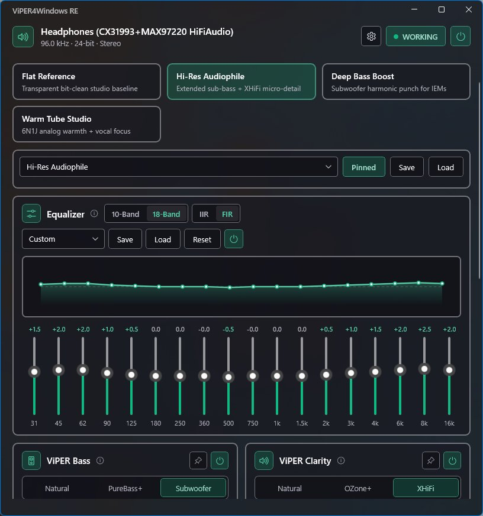
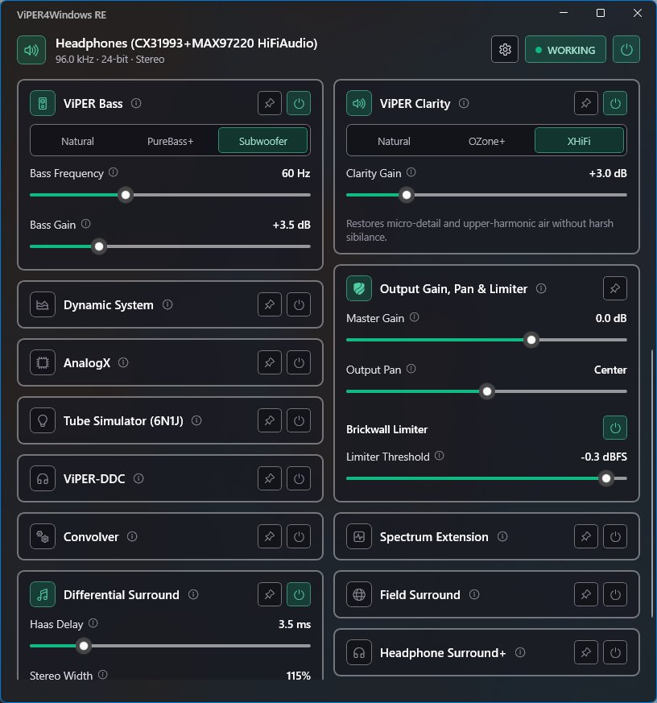

# ViPER4Windows RE

Another **ViPER4Windows RE** — a system-wide audio DSP enhancer for **Windows 10 and Windows 11 (x64)** built with a C++23 MFX Audio Processing Object (APO) and a WinUI 3 desktop interface.

*Architected and built with AI (Google DeepMind / Antigravity), inspired by ViPER4Windows and ViPER4Android FX.*

---

## Screenshots

<p align="center">
  
  
</p>

---

## What It Does

- **Windows 10/11 MFX APO (`ViPERHiResAPO.dll`):** Processes system stereo audio (`44.1 kHz – 384 kHz`, 64-bit internal `double` math) on headphones, speakers, USB DACs, HDMI outputs, and Bluetooth A2DP devices. Non-stereo and telephony formats (`8–24 kHz` / Mono Hands-Free) pass through untouched.
- **Per-Device Attach & Restore:** Install or restore the factory Windows audio configuration for any playback device from **Settings → Devices & APO** (original Registry `FxProperties` are backed up automatically).
- **17 Audio Modules:**
  - **Equalizer:** 10-Band or 18-Band, with selectable **IIR** (low-latency) or **FIR** (2048-tap linear-phase) mode, plus genre EQ presets.
  - **Bass & Clarity:** **ViPER Bass** (*Natural*, *PureBass+*, *Subwoofer* sub-octave synthesis), **ViPER Clarity** (*Natural*, *OZone+*, *XHiFi* with mid-bass anti-mud dip), **Dynamic System** (2-band low/high envelope), **Spectrum Extension**.
  - **Analog Color:** **Tube Simulator (6N1J)**, **AnalogX**.
  - **Correction & Impulse Response:** **ViPER-DDC** (`.vdc` biquad profiles resampled to active sample rate) and **Convolver** (`.irs` / `.wav` partitioned FFT convolution supporting Mono, Stereo, and 4-channel True Stereo).
  - **Spatial & Dynamics:** **Field Surround**, **Headphone Surround+ (VHS+)**, **Differential Surround**, **Cure Tech+**, **Reverberation**, **FET Compressor**, **Playback Gain Control (AGC)**, and **Output Gain, Pan & Brickwall Limiter**.
- **Community Preset Compatibility:** Loads native `.json` presets as well as ViPER4Android community **JSON v1**, **JSON v2**, and **XML** presets (`.json` / `.xml`), `.vdc` profiles, and `.irs` / `.wav` kernels.
- **WinUI 3 Interface & Updates:** Responsive multi-column layout, **Acrylic** & **Dark OLED** themes, custom 1–3 color accents, and built-in GitHub Release update checking (`Settings → About`).

---

## Installation & Updates

1. Download **`ViPER4Windows-RE-Setup-x64.exe`** from [Releases](https://github.com/K4Z3xd/ViPER4Windows-RE/releases).
2. Run the installer (Administrator privileges are required to register the audio APO). By default, setup attaches the APO to your current default Windows playback device.
3. To update later, click **Check for Updates** in **Settings → About**, or download and run a newer installer over your existing installation — your presets, `.irs`, `.vdc`, and settings are preserved.

### Installing on Other Audio Outputs

If you switch to a different playback device (USB DAC, Bluetooth headphones, speakers, HDMI/DisplayPort audio, or S/PDIF), you can attach ViPER4Windows RE to it in two ways:

**Option 1 — Inside the App (Recommended)**
1. Connect or power on the audio output device you want to use.
2. Open **ViPER4Windows RE**, click the **Settings** (gear) icon in the top-right corner, and open **Devices & APO**.
3. Click **Refresh Devices** if the device was just connected.
4. Locate your output device in the list and click **Install / Repair APO** (confirm the Windows Administrator prompt).
5. Windows Audio (`Audiosrv`) restarts briefly and the device status updates to **INSTALLED** (and **ACTIVE** when it is the active playback device).
6. You can install the APO on **multiple output devices** simultaneously. To revert any device to stock Windows audio, click **Restore Factory** on that device.

**Option 2 — PowerShell Command Line (Optional)**
Run an elevated PowerShell window and target either the current default output or a specific device GUID (displayed under each device in **Settings → Devices & APO**):

```powershell
# Attach to the current default playback device
powershell -ExecutionPolicy Bypass -File "C:\Program Files\ViPER4Windows RE\bin\scripts\install_apo.ps1" -AutoDefault

# Attach to a specific playback device by GUID
powershell -ExecutionPolicy Bypass -File "C:\Program Files\ViPER4Windows RE\bin\scripts\install_apo.ps1" -EndpointGuid "{device-guid}"
```

> **Note:** Media players running in **WASAPI Exclusive** or **ASIO** mode bypass all Windows APOs by design. Use standard Windows Shared Mode (or WASAPI Shared) for ViPER4Windows RE processing.

### Installed Folder Layout
```text
C:\Program Files\ViPER4Windows RE\
├── ViPER4WindowsRE.exe   # Launcher
├── bin\                  # App runtime, APO DLL, CLI & scripts
├── irs\                  # Convolver .irs / .wav files
├── vdc\                  # ViPER-DDC .vdc profiles
├── preset\               # Full presets (Flat, Hi-Res, Bass Boost) & preset\eq\
└── logs\                 # APO & installer logs
```

---

## Building from Source

Requires Windows 10/11 (x64), Visual Studio 2022 C++23 Build Tools + Windows 11 SDK, CMake + Ninja, .NET 8 SDK, and Inno Setup 6 (for the installer).

```powershell
# 1. Build C++ DSP engine, APO DLL & CLI tools
cmake -B build -G Ninja -DCMAKE_BUILD_TYPE=Release
cmake --build build --config Release

# 2. Publish WinUI 3 app
cd app
dotnet publish -c Release -p:Platform=x64 -r win-x64 --self-contained true -o ..\installer\stage\app

# 3. Build standalone installer (optional)
& "$env:LOCALAPPDATA\Programs\Inno Setup 6\ISCC.exe" installer\ViPER4WindowsRE-Setup.iss
```

---

## Credits
- **ViPER4Windows & ViPER4Android FX** (ViPER's Audio / Euphy Wong / Team DeWitt) — original audio DSP concepts and `.irs` / `.vdc` ecosystem.
- **AutoEQ** (Jaakko Pasanen) — open-source headphone correction profiles (`.vdc`).
- **Microsoft Windows App SDK & Fluent Design** — WinUI 3 controls, Acrylic backdrop, and Windows Core Audio APO framework.

## License
[MIT License](LICENSE)
